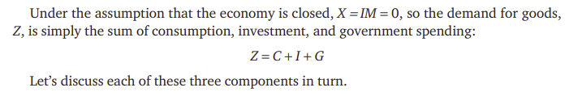
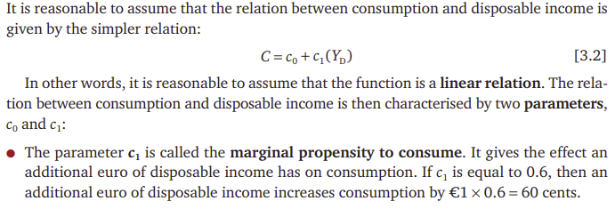
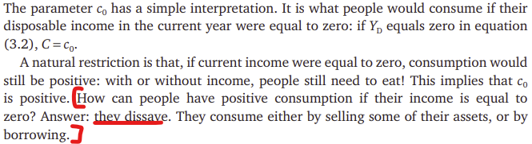
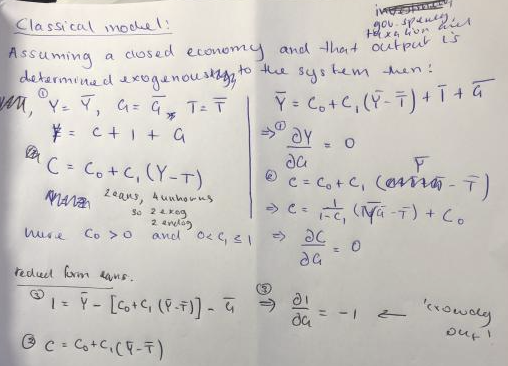
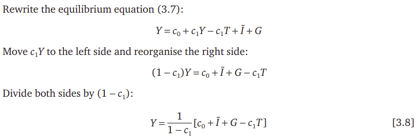

Printed extracts are from Olivier Blanchard, Alessia Amighini and Francesco Giavazzi, *Macroeconomics: A European Perspective*. The supervision questions are the supervisor's; the working and notes are the author's.

Q1) Defining GDP:
NOTE: When defining the difference between real and nominal GDP then use an illustrative example. E.g., if prices double but output unchanged then Nominal GDP would double while real output is simply unchanged.

**What is the Classical model?**

- It is the model that says that output is determined exogenously.
- In that model Y is determined by the production function. This is a system exogenous to the equations for consumption, investment and demand.
- That is demand for goods, $Z$:

1. C is defined endogenously as:

2. NOTE: $Y_D = Y - T$

3. KEY ASSUMPTION of the classical model is that Y IS EXOGENOUS to demand system.
NOTE: Economists take variables 'as a given' or defined exogenously they often put a bar on it. WHENEVER answering a question write a sentence listing out which variable is exogenous and why:

Use full sentences to introduce your model particularly what you assume to be endogenous/exogenous.

4. Finding impact multipliers (NOTE: measures impact of exogenous variables on endogenous variables) by taking partial derivatives e.g./

$$
\frac{dY}{dG} = \frac{1}{1-c_1}
$$

This is the **multiplier** of government spending (exogenous) on output (endogenous). If we are finding $dY/dG$ in this case and $Y$ is exogenous, then $dY/dG = 0$ (see the classical-model working above).
