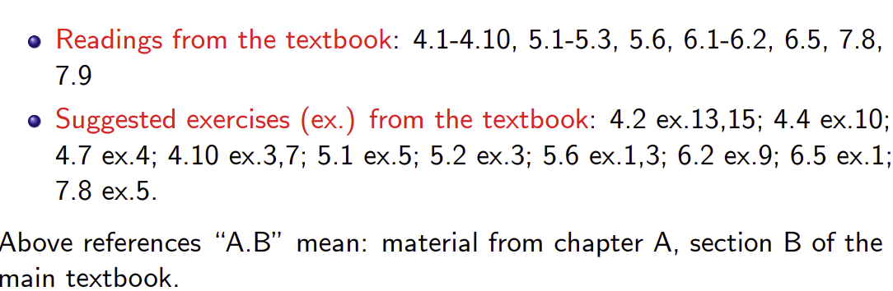
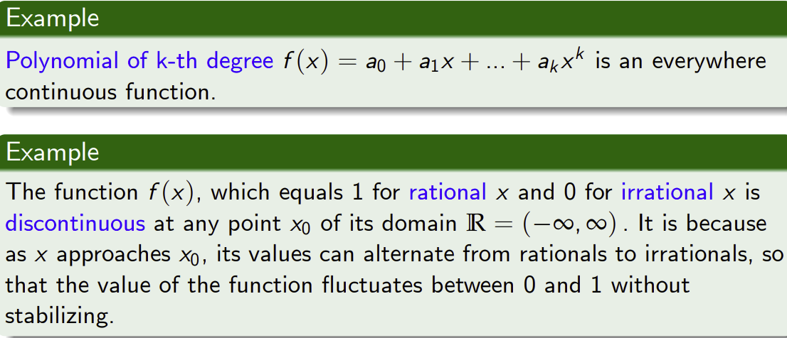
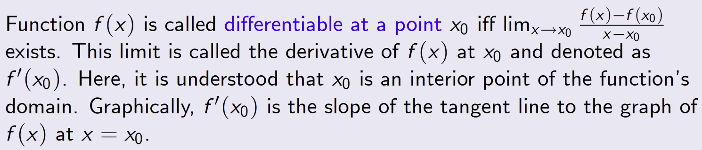
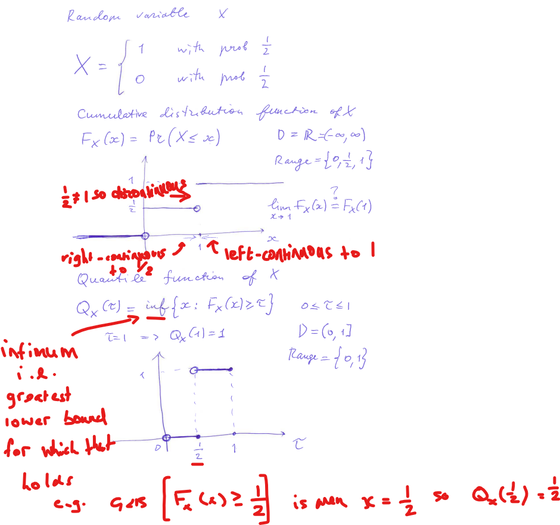

Lecture slide extracts and the worked distribution-function example are from the Part I Mathematics course, University of Cambridge; the red annotations and notes are the author's.

**Reading**

- Main textbook (compulsory): Sydsaeter, K., P. Hammond, A. Strom, and A. Carvajal (2016) Essential Mathematics for Economic Analysis (5th edition), Pearson Education. 
- Supplementary textbook (optional): Pemberton, M., and Rau, N. (2016) Mathematics for Economists: an Introductory Textbook (4th edition), Manchester University Press.

*A good book for those who have done Further Maths modules at A-Level, or who plan to take optional Mathematics paper in Part IIA. Can be borrowed from Marshall Library.*

**Exercises**

**Functions**
Functions have a singular output (range) for a given input (domain). Invertible functions are one to one mappings.

**Continuity** (One-sided)

- Suppose that $f(x)$ is defined on interval $(c, b]$. If $f(x)$ tends to $f(b)$ as $x$ tends to $b$ from left, then we say that $f$ is left-continuous at $x = b$.
- Similarly, if $f(x)$ is defined on $[a, c)$ and tends to $f(a)$ as $x$ tends to $a$ from right, then we say that $f$ is right-continuous at $x = a$

**Continuity**
When both left and right continuity agree to the same value there is continuity at that point.

Function with domain $D = \mathbb{R}$ is called continuous everywhere (or simply, continuous) if it is continuous at any point $x_0$ in $\mathbb{R}$

Now instead consider for example stock prices, they are not continuous because they must always take a rational value.

**Differentiability**

**NOTE: Differentiability ⇒ Continuity but NOT vice versa.**

Consider for example, $f(x) = |x|$. This is continuous everywhere but can not be differentiated at $x=0$.

Marginal quantities use differentiation (even though this is technically an approximation of a unit change) it is justifiable when dealing with extremely large numbers.

**Demonstrating functions and continuity**

