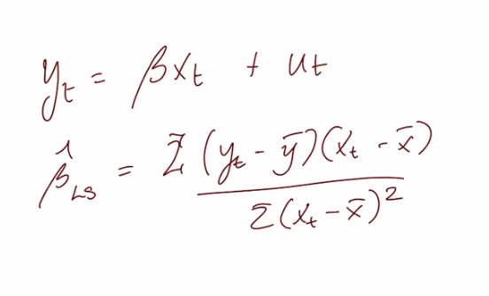
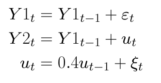
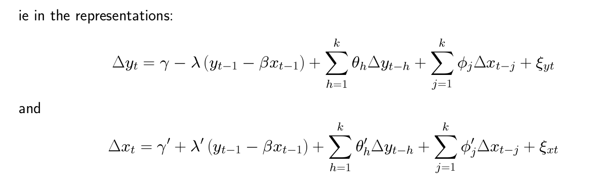
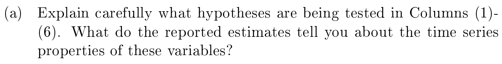
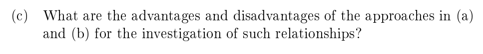

Part IIB Econometrics (Paper 10), Time Series. Reading: Pesaran, *Time Series and Panel Data Econometrics*, Ch. 22. The slide figures are extracts from the course lecture notes, the Pesaran section quotes the textbook, and the past question is Cambridge Economics Tripos Paper 10, 2017.

## Lecture Notes

### Spurious Regression

Suppose we have two independent, non-stationary variables. No relation between $y_t, x_t$.

Nonetheless, if we run a regression of $y_t$ on $x_t$ and still get a significant result for $\hat \beta \neq 0$, even though we know in truth it is zero.
$$
y_t = \alpha + \beta x_t
$$
**This is a spurious regression**, first formalised by Yule (1926).

### Phillips Result

What are the characteristics of a spurious regression? Suppose both $y_t, x_t$ are $I(1)$ processes, they are independent. So, $\beta = 0$

Now by OLS, we estimate,
$$
y_t = \beta x_t + u_t
$$
Our estimate $\hat \beta$ has some results Phillips (1986), **the Phillips result**:

1. **Inconsistent** - $\hat \beta \rightarrow_{p} \text{non-normal random variable} \neq 0$
    1. i.e. it does not converge to zero
    2. this is the spurious regression phenomenon

1. **High** $R^2$ - $\lim_{T\rightarrow \infin} \ R^2 \rightarrow 1$
    1. it looks like a good regression even though misspecified!

1. **Significant t-stats** - $\lim_{T\rightarrow \infin} \ t_{\hat \beta} \rightarrow ±\infin$
    1. it looks like we have significant parameters!

1. **Residuals are non-stationary** - $\hat u_t \sim I(1)$
    1. That is why non-stationarity of residuals is considered a red flag

#### Granger and Newbold Rule of Thumb

This is a rule of thumb
$$
R^2 > DW \implies (\text{potentially spurious})
$$
- The Phillips result tells us that the $R^2$ is high as per spurious regressions
- DW looks at the first-order auto-correlation of the residuals, a low DW indicates high autocorrelation (as you expect if non-stationary)
- So in spurious regressions the DW is very low and the $R^2$ is very high

### Why does it happen?

The OLS formula is Cov(X,Y) divided by Var(X)

Well this is dumb! $X \sim I(1)$, and they have infinite variance!

Also numerator expands to $E[y(x-\bar x)] = \text{stuff}… E[u(x-\bar x)]$, which normally we say that last term is 0 but we can’t do that if we have non-stationarity

### Overcoming Spurious Regression

Difference Everything
- downside if you over-difference you introduce a MA(.)

Use an ARDL (relies on getting the number of lags exactly correct!)
- generally don’t know that
- still end up with non-standard distributions
There is a third class of multiple time series models where relationships between non-stationary variables are to be investigated, and this involves a phenomenon known as **cointegration**

### Cointegration

Cointegration is when the stochastic trends in two I(1) processes nullify each other i.e. a linear combination of two I(1) processes is I(0). Here is why:
With non-stationary processes it is important to discriminate between two situations:
1. Spurious regressions. Apparently significant relationship between unrelated series.
2. Genuine relationships which arise when the time series are cointegrated

#### Cointegration is a special case

Decompose both time series by Beveridge Nelson into the stochastic trend, and the remaining stationary trend and cycle. So,
$$
y_t = C_y\sum^t_{i=1}\epsilon_i +y_0 + \text{stationary}
$$
$C_y, C_x$ are just some multiplier on the unit root process
$$
x_t = C_x\sum^t_{i=1}\eta_i+x_0 + \text{stationary}
$$
The residual term is thus 
$$
y_t - \beta x_t = u_t \\ \ \\ \implies u_t = [C_y\sum^t_{i=1}\epsilon_i - \beta  C_x\sum^t_{i=1}\eta_i] + y_0-\beta x_0 + \text{stationary}
$$
So in general this tells us that $u_t = I(1)$, **but there is a special case when the stochastic trends knock each other out.** That is in scenario where
$$
[C_y\sum^t_{i=1}\epsilon_i - \beta  C_x\sum^t_{i=1}\eta_i] = 0\ \forall t
$$
That means **y and x are co-integrated,** with co-integrating vector ( $1$ $-\beta$ )
$$
y_t - \beta x_t \sim I(0)
$$
To ensure that a spurious regression has not been estimated, it is therefore necessary to ensure that the residuals are stationary. If they are stationary, then we are happy.

#### Visualising Co-integration

- Green line is the error term see that it is stationary

- There is a common stochastic trend here as both are the same AR(1)

#### Examples

**In general, in equilibrium theory, those error terms are indeed mean-reverting. And mean reversion is an I(0) process;** thus variables that are co-integrated actually can exist as per economic theory.

When there’s an equilibrium relationship between variables that themselves could be I(1)
     i. Growth theory models imply cointegration between income, consumption and investment, with productivity being the common trend. 
    ii. Money demand models imply cointegration between money, income, prices and interest rates. 
    iii. The permanent income model implies cointegration between consumption and income, with consumption being the common trend. 
    iv The expectations hypothesis of the term structure implies cointegration between nominal interest rates at different maturities.
     v. The present value model of stock prices states that a stock’s price is an expected discounted present value of its expected future dividends or earnings.
     vi. Covered interest rate parity implies cointegration between forward and spot exchange rates.
     vii Purchasing power parity implies cointegration between the nominal exchange rate and foreign and domestic prices.
     viii. More generally the Law of One Price means we should see cointegration between the prices of goods or assets sold on different markets.

### Cointegration and Causality

Recall the idea of granger causality, that having the history of a variable x and y can improve an estimate of y, just using y’s history means that x granger causes y.

Now let’s suppose x and y are co-integrated. **Granger said the following: if variables are cointegrated, then there’s a valid ECM representation of the data, and vice versa.**

That is to say,

For,  Granger causality in at least one direction at least one of:
$$
\lambda \text{ and or } \lambda' \neq 0
$$
i.e. If y and x are both I(1) and have a long run relationship, there must be some force which pulls the equilibrium error back to zero.
    - and it can be on either side or on both sides

### Testing for Cointegration

Most tests are based on testing the residuals from a cointegrating regression for stationarity.

#### Recast the definition of co-integration to multiple dimensions.

We have a vector of variables $z_t$, these variables are co-integrated if:
- All elements of $z_t$ are of the same order $I(d)$
- There exists a non-zero vector $\beta$ such that $\beta' z_t \sim I(d-b)$ where $b> 0$

That is to say equilibrium between variables of $z_t$ is when they are satisfying: 
$$
\beta ' z_t = 0
$$
- And deviations from this equilibrium must be a lower order process

NOTE: With more than two time series a problem arises in that there may be more than one cointegrating vector between the component series.
- Even with 2 time series the co-integrating vector $(1,-\beta)$ is not unique
- We could use the vector $(k, -k\beta)$ and it would also work
- We resolve this by stating that unique co-integrating vector must be normalised by setting the coefficient on $y_t$ to be 1

#### Two Variables: Unique Cointegration Vector

We have two time series, that we know are I(1). 
$$
x_{1t} \sim I(1) \\ x_{2t}  \sim I(1)
$$
We want to find that  
$$
u_t = x_{1t} - \beta_1 x_{2_t} \sim I(0)
$$
From theory we argue that this stationarity happens if 
$$
x_{1t} - \beta_2 x_{2t} \sim I(0)
$$
That means 
$$
x_{1t} - \beta x_{2t} =  x_{1t} - \beta x_{1t} +(\beta_1 -\beta_2) x_{2t}   \\ \ \\ = u_t+(\beta_1 -\beta_2) x_{2t} 
$$
So our theorised cointegration vector, is only stationary if 
$$
\beta_1 = \beta_2
$$
The cointegration vector thus must be unique. With more variables the possibility of multiple cointegrating vectors must be considered. 

#### $\beta$ is known

If we actually know from theory what the co-integrating vector is. 
Then all we have to do is estimate under this known vector, what the residuals are, and then test if they are stationary.
i.e.
1. Construct $u_t = \beta' z_t$
2. Test for stationarity using Augmented Dickey Fuller
3. If stationary then there is co-integration

If it is not known, then first we have to estimate it.

#### Engle-Granger Method

Again we continue to assume that there is a unique co-integrating vector.
Suppose we have a variable $y_t$ and a set of explanatory variables $x_{1t},x_{2t},...,x_{kt}$. 
Suppose each of these series is individually known (we usually pre-test) to be I(1).

1. Estimate the static regression  by OLS
$$
y_t = \beta_0 + \beta_1 x_{1t}+ \dots + \beta_kx_{kt} + \epsilon_t
$$
- The static relationship estimated above can be interpreted as the long-run relationship between the set of variables.

1. Obtain the fitted residuals 
$$
\hat e_t = y_t - \hat \beta_0 - \hat  \beta_1 x_{1t}+ \dots -\hat \beta_kx_{kt}
$$

1. Cointegration will be tested by testing these residuals for unit root. We run the DF test that is 
$$
\Delta e_t = \rho e_{t-1} + ξ_t
$$
- $H_0: \rho = 0$ (unit root → no cointegration) vs. $H_1: \rho < 0$ (stationary)

If we have established that there is co-integration. Then the next step is to understand by what process exactly does $y_t$ return to its long-run value, we estimate an ECM. (Every co-integrated process can be represented as an ECM).

1. Estimate the error-correcting model, with the error from last period (s.t. correction), j lags of $\Delta x$ for all $k$ regressors and finally, h lags of $\Delta y$ 
$$
\Delta y_t = \phi_0 +\phi_1 \Delta y_{t-1} + \dots \phi_h \Delta_h y_{t-h} + \sum_{j=0}^k \psi_j \ \Delta x_{t-j} + \lambda \hat u_{t-1} + \epsilon_t
$$
Note that this formulation ensures that the long-run implied equilibrium relationship from the dynamic regression is exactly that implied by the cointegration regression. The coefficient λ (which should be negative) calibrates how quickly the equilibrium relationship is restored.

Forecasting
This also ensures that long horizon forecasts obey the equilibrium relationship but it does still leave the problem of how do we forecast the x’s.
- What we would like in many circumstances is a structure that produces forecasts for both x and y together.
- Also, when there is more than one cointegrating vector the above single equation methods will not work.
    - In general if the vector zt has n components there may be r linearly independent cointegrating vectors where $r \le n - 1$. 
To proceed an approach based on system estimation must be used

Care Needs to be Taken
- We do not include a constant in this regression since the residuals from an OLS regression have zero mean by construction.
- The appropriate critical values differ from the usual Dickey-Fuller ones. The critical values for residual based cointegrating tests are tabulated by Engle and Yoo.
    - This procedure suffers from the fact that these critical values depend on the number of regressors in the model
- To remove serial correlation could have added lagged values of $\Delta e_t$
- **Coefficient estimates are super-consistent,** in that they approach their true values at rate T rather than the conventional √T.

#### Durbin Watson Method

An alternative test for cointegration is based on the Durbin-Watson statistic from the cointegrating regression.
**If there is no cointegration then the residuals will have a unit root and the DW statistic should be near zero.**

## Pesaran Ch.22

### Cointegration

r = dimension of cointegrating space i.e. no. of cointegrating vectors

The co-integrating relations summarised in the r x 1 vector are also known **as long-run relations.**

### Testing Cointegration

The Engle-Granger Method: see the lecture-note procedure above.

## Past Question

### Q2 2017: Engle-Granger vs VECM

This is the Engle and Granger 2-step method to test for co-integration. 
What you do is: 
1. First establish whether two variables, Y1 Y2, have a unit root, using ADF test
    1. If both are I(1), proceed. 
2. Estimate the long-run relationship by just running a typical OLS.
    1. This could be significant relationship because of spurious regression
    2. We need to go further: extract the residuals $\hat u_t$, 
3. We test whether residuals of LR relation have a unit root, using ADF test. 
    1. We want to reject the unit root null, that implies residuals are I(0).
    2. If $\hat u_t$ is I(0), proceed, the variables are co-integrated. 
4. Estimate the individual ECMs for each variable, **by regressing the change in Y against the lagged error term, to see if Y reacts to disequilibrium with other Y.**
    1. $ECM: \ \ \ \Delta Y_{1, \ t} = \alpha + \beta_1 \Delta Y_{1, \ t-1} + \beta_2 \Delta Y_{2, \ t-1} + \lambda_1 \hat u_{t-1}$
    2. Key parameter here is $\lambda$, other terms are just to mop up auto-correlation. 
5. Find which ECMs have significant $\lambda$ parameters. If there is significance then that variable ‘adjusts’ to the other one’s fluctuations, so it is ‘Granger caused’ by it. 
    1. i.e. $\lambda_1 \ \ \text{significant} \implies Y_1 \text{ is granger caused by } Y_2$

*Note to self that a transposition operation runs anti-clockwise.*

