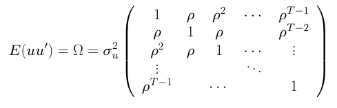
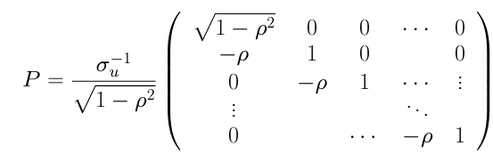
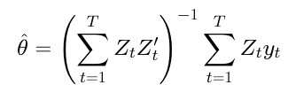
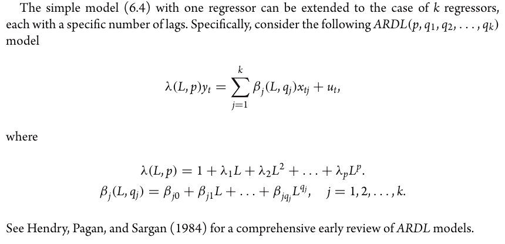
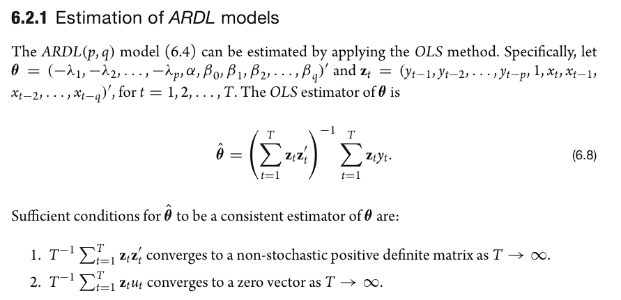
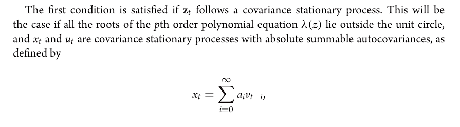
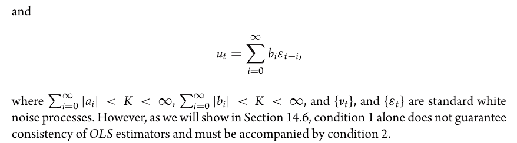
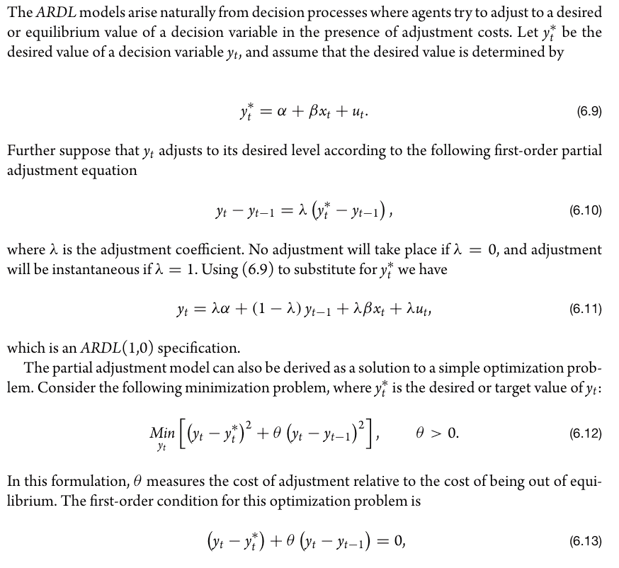
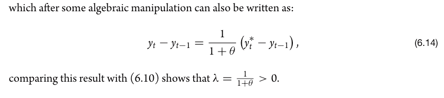

Part IIB Econometrics (Paper 10), Time Series. Reading: Pesaran, *Time Series and Panel Data Econometrics*, Ch. 6. The matrix figures are extracts from the course lecture notes, and the Pesaran section quotes the textbook.

## Lecture Notes

### Regression and Autocorrelation

Regressive models go beyond univariate modelling, we allow the function to be generated not just by its lags and some errors but also **be influenced by other variables** in a causal relationship.

OLS regression of time series e.g. 
$$
y_t = \beta x_t + u_t
$$
will not be efficient if there is autocorrelation.

There are three ways to eliminate this autocorrelation, namely, 
1. **Make errors uncorrelated** - by using Prais-Winsten or Cochrane-Orcutt methods to specify the relation i.e. this is a GLS method
2. **Include the omitted dynamics** - we use ARDL models that will overcome the misspecification of omitted dynamics.
3. **HAC standard errors** (heteroscedasticity, and auto-correlation corrected)

### Prais-Winsten, Cochrane-Orcutt (GLS)

We seek to estimate the auto-correlation, we believe it is an AR(1) process 
$$
y_t = \beta x_t + u_t \\ \ \\ u_t = \rho u_{t-1} + \epsilon_t
$$
- where $\epsilon$ is not introducing endogeneity as $E(\epsilon | x) = 0$ and, $E(\epsilon^2 | X) = \sigma^2 I_t$, $I_t$ is identity matrix

Define the set of errors over time as
$$
u = \begin{bmatrix}
     	   u_{1} \\
           u_{2} \\
           \vdots \\
           u_{t}
         \end{bmatrix}
$$

#### Variance-Covariance Matrix

The variance-covariance matrix of $u$ is 

- **The Diagonal:** Notice the $1$s running down the center. This represents the variance of the error at any given time $t$.
- **The Off-Diagonal:** Notice the $\rho, \rho^2, \rho^3...$ terms. These show that the error today is correlated with the error tomorrow ($\rho$), day after ($\rho^2$), etc.
- **The Meaning:** Because the off-diagonals are not zero, we cannot use regular OLS. We need a "weighting matrix" to clean this up.
- $\sigma^2_u$ = unconditional variance, so for diagonals it is active for off-diagonals it is dampened.

#### The $P$ Matrix

In GLS, we look for a matrix $P$ that "whitens" the errors. Think of $P$ as a **filter**. When we multiply our data by $P$, it removes the patterns in the errors, leaving only the white noise.

The matrix $P$ is a specific construction designed so that $P \Omega P' = I$.

**To find $P$, we effectively need to find the "square root" of the inverse of $\Omega$.** We use a method called Cholesky Decomposition.
$$
\Omega = \sigma^2_u (\text{Correlation Matrix}) \\ \ \\ \implies \Omega^{-1} = \sigma_u^{-2} (\text{Correlation Matrix})^{-1}
$$
but the inverse correlation matrix is the standard AR(1) tridiagonal form.
This final part requires **Cholesky decomposition**, it finds a lower-triangular matrix $M$ s.t. $M'M = \Omega^{-1}$
$$
 \implies \sqrt{\Omega^{-1}} = P =  \frac{\sigma_u^{-1}}{\sqrt {1-\rho^2}} \times \sqrt {(\text{Scaled Correlation Matrix}^{-1})}
$$

- Note that the top left is the only one that is 1, this is because $y_0$ is a known constant.

Thus GLS here amounts to regressing 
$$
\text{for t =1: } \sqrt{1 - \rho^2} \ y_1 = \sqrt{1 - \rho^2} \ \beta x_1 + \sqrt{1 - \rho^2} \ u_1 \\ \ \\ \text{for t > 1: }y_t - \rho y_{t-1} = (x_t - \rho x_{t-1}) \beta + u_t - \rho u_{t-1}
$$

| **Observation** | **Transformed Equation** |
| --- | --- |
| **First** $t=1$ | $\sqrt{1-\rho^2}y_1 = \beta(\sqrt{1-\rho^2}x_1) + \text{error}$ |
| **Others** $t>1$ | $(y_t - \rho y_{t-1}) = \beta(x_t - \rho x_{t-1}) + \varepsilon_t$ |

- **Prais-Winsten** does this scalar transform to the first observation so that it can be kept.
- Cochrane-Orcutt **discards the first observation** and only uses the quasi-differenced equations. 

In small datasets, losing the first observation (Cochrane-Orcutt) can lead to a significant loss of statistical power. 

Prais-Winsten is generally preferred because it uses all $T$ observations. 

#### Feasible Prais-Winsten Process

Of course we do not know the actual variance-covariance matrix, we have to estimate it.

1. Get the residuals $\hat u_t$
Run the regression of OLS 
$$
y_t = \beta x_t + u_t
$$
Even though OLS is inefficient here, it is still "consistent," meaning the residuals $(\hat{u}_t)$ you get are good estimates of the actual errors.

2. Estimate $\rho$
You run the second regression to specify the AR(1) 
$$
\hat u = \rho \hat u_{t-1} + \epsilon _t
$$
3. Do the GLS regression
You then use $\hat \rho$, in your P matrix to transform the data and do the final clean regression.

### ARDL Models

Autocorrelation of errors can also be taken as a sign that there are omitted dynamics in the regression. 
That is $y_t, x_t$ may be autocorrelated and their relationship varies over time. So we just use all the lagged values of y and x in an **autoregressive distributed lag model**
$$
y_t =  α+ϕ_1y_{t−1} +...+ϕ_hy_{t−h} +β_0x_t +β_1x_{t−1} +β_2x_{t−2} +...+β_kx_{t−k} +u_t
$$

#### Stability

The model is stable if the roots of the characteristic equation 
$$
\Phi(z) = 1-\phi_1z-\phi_2z^2-\dots \phi_hz^h = 0
$$
lie **outside the unit circle** 

#### Consistency

Let $\theta_t = (\alpha, \phi_1, ... \phi_{h}, \beta_1 ...,  \beta_h)$ and let $Z_t = (1, y_{t-1},...  , y_{t-h}, x_{t-1}, ..., x_{t-k})'$ and so the OLS estimator is 

For this to be consistent as T tends to $\infin$, we have two sufficient rules.

1. **Stability**
$$
T^{-1} \sum Z_t Z_t' \rightarrow \text{stable, positive-definite matrix}
$$
- If this sum doesn't stabilize, the "denominator" of your OLS fraction is essentially moving or becoming zero.
- This is why $Z_t$ is implied stationary; if data is "trending" or exploding (non-stationary), the sum will keep growing to infinity, and the OLS math breaks down
- i.e. each individual $x_t$ is stationary
- and overall characteristic equation meets the stability condition

2. **Exogeneity**
$$
T^{-1} \sum Z_t u_t \rightarrow \text{zero vector}
$$
- Errors cannot be correlated with regressors
- If your error term (the stuff you can't see) is moving in sync with your independent variables, OLS will mistakenly "credit" that movement to your independent variables

#### SR and LR responses

The short run response, is what happens to $y_t$ to a change in $x_t$, by partial differentiation.
$$
y_t =  α+ϕ_1y_{t−1} +...+ϕ_hy_{t−h} +β_0x_t +β_1x_{t−1} +β_2x_{t−2} +...+β_kx_{t−k} +u_t \\ \ \\ \implies \frac{\partial y_t}{\partial x_t} = \beta_0
$$
The long run response is the new steady-state for $y^*$
$$
y^*=  α+ϕ_1y^* +...+ϕ_hy^* +β_0x^* +β_1x^* +...+β_kx^*
$$
So we can collect terms, to get that 
$$
y^*(1 - \sum \phi) = \alpha + x^*(\sum \beta)
$$
Thus, the LR response is as required: 
$$
\frac{\partial y^*}{\partial x^*} = \frac{\sum_{i=0}^k \beta_{i}}{1-\sum_{j=1}^h \phi_j}
$$

## Pesaran Ch.6

Dynamic models arise as a characterisation of the path of the economy around its LR equilibrium (steady state). 
This chapter reviews a number of single-equation specifications suggested by econometric literature to represent dynamics in regression models.

#### **Polynomial DL Model**

A general specification for the polynomial distributed lag (DL) model is
$$
y_t = \alpha + \beta_0 x_t + \dots + \beta_q x_{t-q} + u_t \\ \ \\ = \alpha + \beta(L) x_t + u_t
$$
- $u_t$ is assumed serially uncorrelated
- $\beta (L)$ $=\beta_0 + \beta_1L+... \beta_qL^q$ is a lag polynomial

#### **Rational DL Model**

This time we have that 
$$
y_t = \alpha + \frac{\beta(L)}{\lambda(L)} x_t + v_t
$$
- $\lambda(L) = \lambda_0 + \lambda_1L + ... \lambda_p L^p$

#### **ARDL Model of order (p,q)**

The ARDL model is 
$$
\lambda (L) y_t = \alpha + \beta(L) x_t + u_t
$$
This can also be written in the form of a MA 
$$
\lambda (L) y_t = \alpha\lambda (L)  + \beta(L) x_t + \lambda (L) v_t
$$
- where $u_t = \lambda (L) v_t$ is itself an MA model
- the alpha here is 1/p of the original alpha

You can throw in a deterministic trend or seasonal dummies too if you want.

**Stability of ARDL**
This is stable if roots of the pth order polynomial lies outside the unit circle 
$$
\lambda(z) = 1+ \lambda_1z + \lambda_2z^2 + \dots \lambda_p z^p = 0
$$
- where $|z| > 1$

There is a unit root if $\lambda(1) =0$, explosive case if $\lambda(z) = 0$ has roots that lies *inside* the unit circle

**k regressors**

- each regressor has its own lag polynomial for its betas
- $\beta_j(L, q_j)$ reflects the lag polynomial of regressor j, where $q_j$ is the specified number of lags used

**Estimation of ARDL Models**

- The first condition is indeed stationarity
    
    

#### **Partial adjustment model**

This is why ARDL models are natural; they reflect the presence of adjustment costs.

